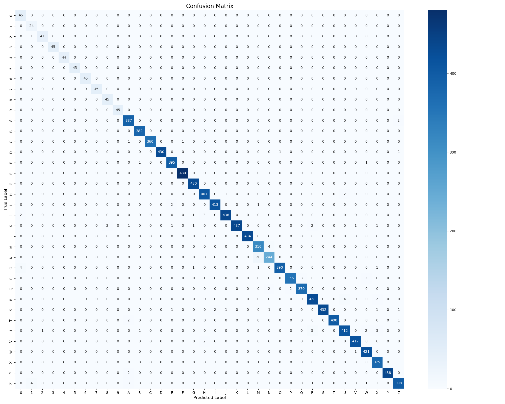
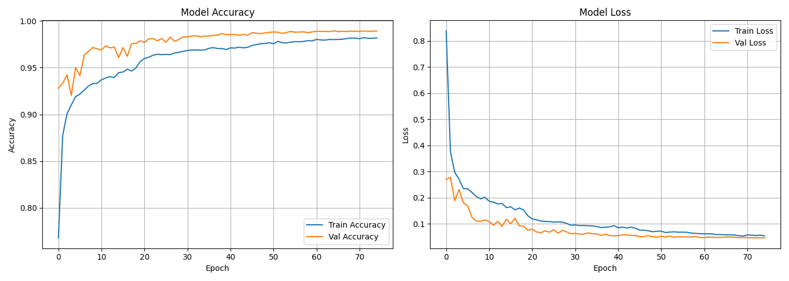

# 🤟 Sign Language Detection

A real-time system that recognizes the American Sign Language (ASL) alphabet and digits from a webcam and shows the result on screen, so a signed letter or number becomes readable text.

<!-- DEMO -->

---

## About the project

| | |
|---|---|
| **Problem** | Most people cannot read sign language. I wanted a small system that turns a hand sign into a letter or digit, live, using only a normal webcam. |
| **Input** | Live webcam video (one hand in view). |
| **Output** | The predicted letter (A–Z) or digit (0–9) on screen with a confidence bar, plus a sentence builder that collects letters into words. |
| **What it recognizes** | 36 classes: 26 letters and 10 digits, left or right hand. |
| **Who it could help** | Learners practicing ASL, and a base for tools that translate signs for people who do not know them. |
| **My role** | Solo project: I collected data, built the whole pipeline, trained and evaluated the model, and wrote the real-time app. |
| **Duration** | About 5 days. |
| **Tools** | Python, MediaPipe Hands, OpenCV, TensorFlow/Keras, NumPy, pandas, scikit-learn, Matplotlib |

---

## Results

| Metric | Value |
|---|---|
| Overall test accuracy | **98.87%** (test set = 15% of the data) |
| Average prediction confidence | 99.4% |
| Real-time speed | 20+ FPS on a laptop |
| Model file size | 806 KB, about 60,000 parameters |
| Training time | about 5 minutes on a laptop |
| Letters A–Z accuracy | 94–100% per letter |
| Digits 2–9 accuracy | 97–100% per digit |
| Weakest classes | digit 0 (88.2%), digit 1 (82.8%) |

<p>
  
  
</p>

**Honest note on the numbers:** the test set is a random split of the same dataset (70/15/15 train/validation/test, stratified). Many images in the dataset are similar frames of the same hand, so accuracy on a brand new person or a different camera and lighting is likely lower than 98.87%. Testing on new signers is the first thing I would do next.

---

## How it works

```
Webcam frame
   ↓  MediaPipe Hands: 21 hand landmarks (x, y, z)
   ↓  Normalize: wrist moved to the origin, scaled by wrist-to-middle-finger distance
   ↓  63 numbers (21 × 3)
   ↓  Neural network (MLP)
   ↓  36 class probabilities
   ↓  Confidence ≥ 0.85 and majority vote over the last 7 frames
Letter / digit on screen
```

Instead of feeding raw images to a big image model, I extract the hand skeleton first and classify only 63 numbers. This keeps the model tiny (806 KB), fast on a laptop CPU, and independent of the background, and independent of where the hand is and how big it appears, because normalization removes position and size.

**Model:**
```
Input (63)
  → Dense(256, ReLU) → BatchNorm → Dropout(0.3)
  → Dense(128, ReLU) → BatchNorm → Dropout(0.3)
  → Dense(64,  ReLU) → BatchNorm → Dropout(0.3)
  → Dense(36, Softmax)
```
Adam optimizer (lr 0.001), batch size 32, up to 100 epochs with early stopping (patience 10).

---

## Dataset

| Source | Content |
|---|---|
| Kaggle "ASL Alphabet" | about 3,000 images per letter (A–Z) |
| My own webcam frames | 300 frames per class for all 36 classes (letters and digits) |
| **Total** | **88,800 images** (26 letters × 3,300 + 10 digits × 300) |

After pose extraction, **72,901 samples** remained (82.1%). The rest were images where MediaPipe did not find a hand.

The full dataset is not stored in this repository (88,800 files is too large for GitHub). `data/samples/` has one of my own webcam frames for every class (36 images) so you can see what the data looks like. To retrain, download the Kaggle dataset, put the images in `data/raw/<CLASS>/`, and collect your own with `collect_data.py`.

---

## 🧩 Problems I hit and how I solved them

**1. Library version conflicts (MediaPipe, OpenCV, NumPy, protobuf, TensorFlow).**
These packages broke each other on my Mac depending on install order and versions. I made a clean conda environment, found a combination that works, and pinned the exact versions in `requirements.txt` (NumPy 1.24.3, protobuf 3.20.3, OpenCV 4.8.1.78, MediaPipe 0.10.9, TensorFlow 2.15.0).

**2. 17.9% of the images had no detectable hand.**
MediaPipe could not find a hand in about 1 of every 6 images. I dropped those instead of guessing, which left 72,901 clean samples.

**3. Imbalanced classes: letters have 3,300 images, digits only 300.**
The digits are my own webcam data only, so they have about 10× fewer samples. This is why digits 0 and 1 are the weakest classes (88.2% and 82.8%). The fix is more digit data, which is the first item in my next steps.

**4. Predictions flickered on live video.**
A single frame can be misread, so the label jumped between letters. I added two filters: a confidence threshold (below 0.85 shows "Unknown") and a majority vote over the last 7 frames. The live output became stable.

**5. The model failed to load across TensorFlow versions.**
A model trained in one TensorFlow version would not load in another. I now train and run in the same pinned environment.

**6. The repository was 1.2 GB.**
I had committed all 88,800 training images by mistake, even though they were in `.gitignore` (git keeps tracking a file once it has been added). I removed them from the whole git history, so the repository is now small and clones in seconds.

---

## Limitations and next steps

- **Motion letters:** J and Z are drawn in the air, but the system looks at one frame at a time, so they are less reliable.
- **Digits 0 and 1:** need more training data.
- **New people and cameras:** test on other signers, and split train and test by person instead of randomly.
- **Words:** the sentence builder only joins letters. A next step is a spell-corrector or a model for whole signs.

---

## Try it in 2 minutes (no retraining needed)

The trained model is included, so you can run the live demo right after cloning.

```bash
git clone https://github.com/Umid-R/Sign_Language_Detection.git
cd Sign_Language_Detection

conda create -n sign_lang python=3.10 -y
conda activate sign_lang
pip install -r requirements.txt

python inference_realtime.py
```

Controls: `Q` quit, `C` clear the sentence, `Space` add a space.

To check the results yourself: `python evaluate.py` (uses the included test set).

### Retrain from scratch
```bash
python collect_data.py      # optional: capture your own frames (Space = capture, Q = quit)
python extract_poses.py     # images → 63-number landmark vectors (1–2 hours for the full set)
python train.py             # trains the model, saves models/best_model.h5 and the plots
python evaluate.py          # per-class report and confusion matrix
```

---

## Project structure

```
├── collect_data.py          # capture webcam frames per gesture
├── extract_poses.py         # MediaPipe landmarks → normalized vectors
├── train.py                 # train the MLP classifier
├── evaluate.py              # test accuracy, per-class report, confusion matrix
├── inference_realtime.py    # live webcam app
├── config.py                # all settings in one place
├── models/                  # trained model + label encoder
├── plots/                   # confusion matrix, training curves
├── data/samples/            # 1 example webcam frame per class
├── data/poses/              # test split (X_test.npy, y_test.npy)
└── requirements.txt
```

All settings (batch size, epochs, dropout, confidence threshold, smoothing window) are in `config.py`.
